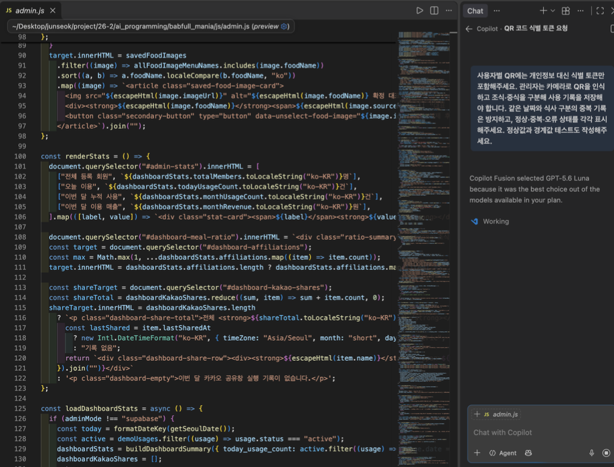
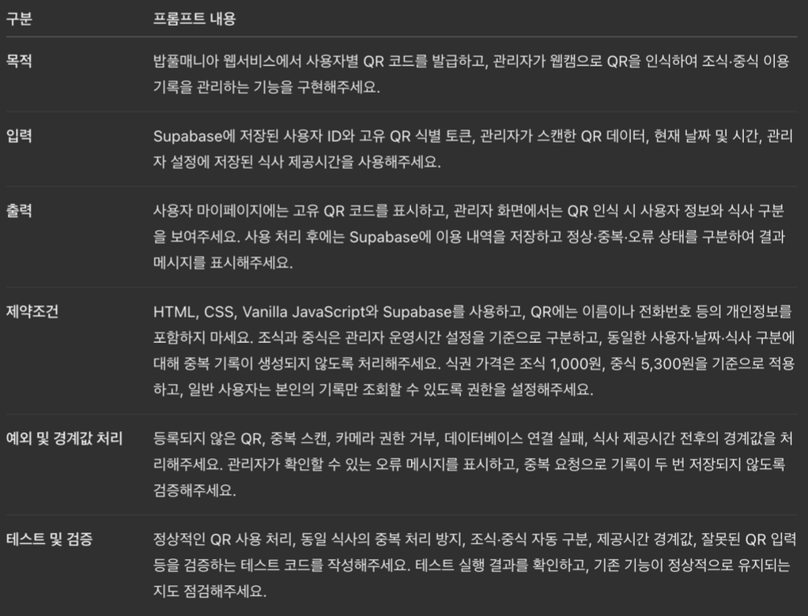
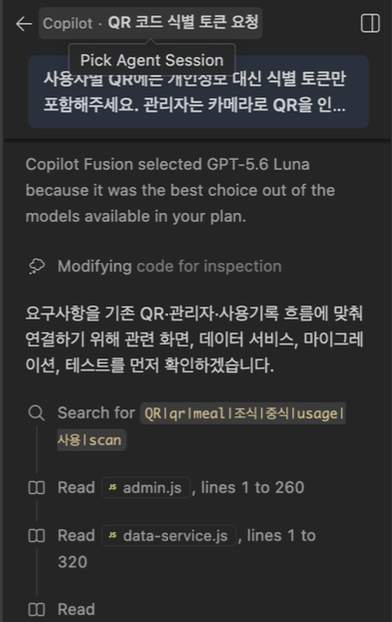
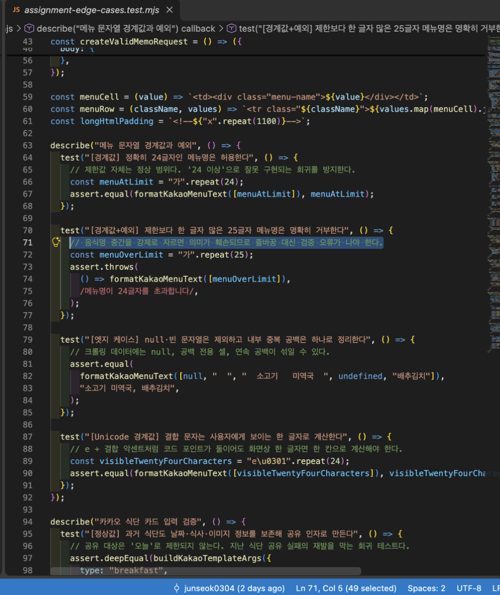
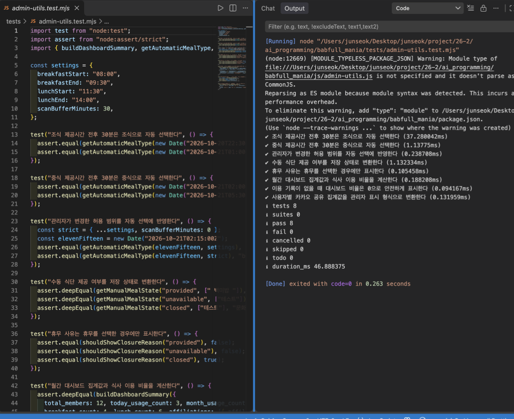
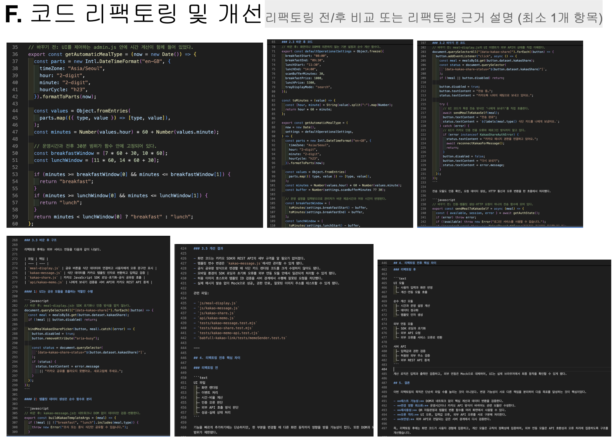
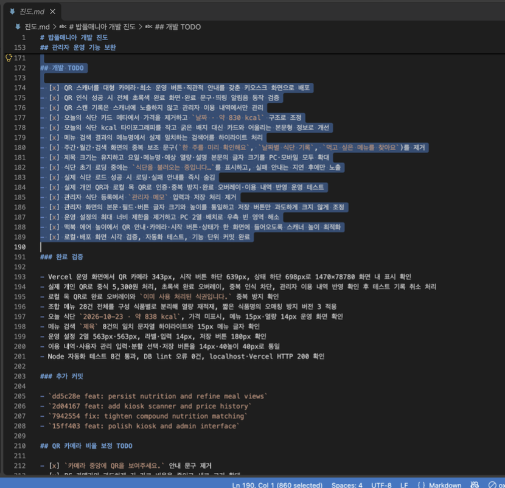

<div align="center">


# 밥풀매니아

### 오늘의 학식을 가장 쉽고 맛있게 확인하는 방법

성공회대학교 학식 메뉴를 식판 이미지와 예상 열량으로 한눈에 보여주는 반응형 웹 서비스입니다.

[**서비스 바로가기**](https://babfullmania.vercel.app/#home)

</div>


## 프로젝트 소개

밥풀매니아는 텍스트 위주의 학식표를 실제 식사 선택에 도움이 되는 화면으로 바꿉니다. 조식·중식 메뉴와 제공시간, 가격, 예상 열량을 함께 안내하고, 메뉴를 반영해 제작·검수한 식판 이미지로 한 끼의 구성을 직관적으로 보여줍니다.

식단 탐색뿐 아니라 공지·건의, 카카오톡 공유, 식단 및 이미지 운영, 이용 통계까지 하나의 서비스에서 관리할 수 있도록 구현했습니다.

## 주요 기능

- **오늘의 식단**: 조식·중식 메뉴, 제공시간, 가격과 예상 열량을 확인합니다.
- **식판 이미지**: 등록된 메뉴만 반영한 완성 식판 이미지 또는 메뉴별 대표 사진을 보여줍니다.
- **주간·월간 탐색**: 주 5일 식단과 월력형 과거 식단을 조회합니다.
- **메뉴 검색**: 과거 식단을 포함해 원하는 메뉴와 제공 날짜를 검색합니다.
- **카카오톡 공유**: 조식·중식 카드를 카카오톡 친구나 채팅방에 공유합니다.
- **공지·건의**: 운영 공지를 확인하고 공개 또는 비밀 건의사항을 작성합니다.
- **관리자 콘솔**: 식단, 제공 여부, 가격, 메뉴 사진, 공지, 사용자와 이용 기록을 관리합니다.
- **QR 식권 관리**: 개인 QR 발급, 관리자 스캔, 중복 사용 방지와 이용 기록·통계를 제공합니다.

## 중간고사 MVP 구현 현황

중간고사에서 계획한 핵심 기능을 기준으로 최종 구현 상태를 점검했습니다.

| MVP 기능 | 구현 상태 | 구현 및 변경 내용 |
| --- | --- | --- |
| 오늘의 식단 조회 | 완성 | 조식·중식 메뉴, 가격, 예상 열량 및 시간대별 화면 전환 |
| 주간·월간 식단 조회 | 완성 | 날짜별 식단과 과거 메뉴 조회 |
| 식판 이미지 시각화 | 완성 | AI로 사전 생성·검수한 식판 이미지를 Supabase Storage에 저장하고 재사용 |
| 메뉴명 검색 | 완성 | 음식 이름으로 과거 제공 날짜와 식사 구분 검색 |
| QR 식권 및 관리자 관리 | 완성 | QR 발급·스캔·중복 사용 방지·이용 기록·관리자 통계 구현 및 테스트 완료 |

QR 식권은 본 프로젝트에서 정의한 웹서비스 기능 범위에 따라 발급부터 관리자 처리, 이용 기록과 통계까지 구현하고 정상·중복 사용 상황을 테스트했습니다.

## 중간고사 계획 변경 사항 및 이유

| 항목 | 중간고사 계획 | 최종 구현 | 변경 이유 |
| --- | --- | --- | --- |
| 프론트엔드 | React | HTML, CSS, Vanilla JavaScript | 수업에서 학습한 JavaScript를 직접 활용하고 구현 복잡도를 줄이기 위해 변경 |
| 백엔드 | Java | Supabase Edge Functions, Vercel API | 별도 서버 구축 부담을 줄이고 기능 구현 및 검증에 집중 |
| 데이터베이스 | MySQL | Supabase PostgreSQL | 관계형 DB와 SQL을 활용하면서 인증·스토리지·접근 제어를 연계하기 위해 변경 |
| 로그인 | 휴대폰 모의 인증 | 카카오 OAuth 및 Supabase Auth | 모의 인증의 한계를 개선하고 실제 계정 기반 로그인 제공 |
| 식판 이미지 | AI 생성 또는 웹 이미지 검색 | 이미지 사전 생성·검수 및 Storage 저장 | 실시간 생성 비용과 대기시간을 줄이고 이미지 품질을 관리 |
| QR 식권 | 정기식권 관리 | QR 발급·스캔·이용 기록·통계가 연결된 웹 관리 기능 | 웹에서 전체 사용 흐름을 재현하고 중복 사용 방지와 관리자 처리를 함께 검증하기 위해 구체화 |

초기에는 다양한 기술을 함께 도입하려 했으나, 교수님의 피드백을 반영하여 수업에서 학습한 기술과 핵심 MVP 구현에 집중했습니다.

기술 스택을 간소화하면서도 식단 조회와 QR 관리 기능은 유지했으며, 테스트와 리팩토링을 통해 구현 결과를 검증했습니다.

## 실행 화면

<table>
  <tr>
    <td width="50%" align="center">
      <br />
      <sub><b>주간 식단과 예상 열량</b></sub>
    </td>
    <td width="50%" align="center">
      <br />
      <sub><b>월간 메뉴 탐색</b></sub>
    </td>
  </tr>
  <tr>
    <td width="50%" align="center">
      <br />
      <sub><b>모바일 메뉴 검색</b></sub>
    </td>
    <td width="50%" align="center">
      <br />
      <sub><b>모바일 식판 이미지</b></sub>
    </td>
  </tr>
  <tr>
    <td colspan="2" align="center">
      <br />
      <sub><b>카카오톡 식단 카드 공유</b></sub>
    </td>
  </tr>
</table>

## 기술 구성

| 영역 | 사용 기술 |
| --- | --- |
| 사용자·관리자 화면 | HTML, CSS, Vanilla JavaScript |
| 데이터·인증·파일 | Supabase PostgreSQL, Auth, Storage, Edge Functions |
| 배포·서버리스 API | Vercel, Node.js API Functions |
| 카카오 기능 | Kakao Login, Share SDK, Memo API 검증 모듈 |
| 외부 데이터 | 식품안전나라·공공데이터포털 식품영양성분 데이터 |
| 품질 검증 | Node.js Test Runner, TypeScript |

## 로컬에서 실행하기

화면만 확인하려면 **1·2·6번**만 진행하면 됩니다. 카카오 로그인과 실제 데이터 저장까지 연결하려는 개발자는 전체 순서를 진행하세요.

### 1. 코드 내려받기

다음 환경을 기준으로 실행합니다.

| 항목 | 권장 환경 | 용도 |
| --- | --- | --- |
| Git | 2.x 이상 | 저장소 내려받기 |
| Node.js | 20 이상 | 테스트와 카카오 TypeScript 모듈 실행 |
| npm | Node.js 20에 포함된 버전 | 패키지 설치와 명령 실행 |
| Python | 3.10 이상 | 로컬 정적 웹 서버 실행 |
| 브라우저 | 최신 Chrome, Edge 또는 Safari | 사용자·관리자 화면 확인 |

프론트엔드는 별도의 빌드 패키지가 필요하지 않습니다. 카카오 검증 모듈에 필요한 패키지는 아래 `npm ci` 명령으로 `package-lock.json`에 고정된 버전을 설치합니다.

```bash
git clone https://github.com/junseok0304/babfull_mania.git
cd babfull_mania
npm --prefix babfull-kakao-link ci
```

### 2. 데모 화면 먼저 확인하기

```bash
npm run dev
```

- 사용자 화면: `http://localhost:4173/?demo=1#home`
- 관리자 데모: `http://localhost:4173/admin/?demo=1`

`demo=1`은 외부 계정이나 데이터베이스 없이 시연 데이터로 UI를 확인하는 모드입니다. Windows에서 `python3` 명령을 찾지 못하면 저장소 루트에서 `py -m http.server 4173`을 실행하세요.

## 환경변수와 외부 서비스 연결

아래 3~5번은 실제 로그인과 데이터 저장을 연결하는 운영자용 절차입니다. 데모 화면만 확인한다면 건너뛰어도 됩니다.

### 3. 카카오 개발자 콘솔 설정하기

1. 카카오 디벨로퍼스에서 애플리케이션을 만들고 **카카오 로그인**을 활성화합니다.
2. 로컬 주소와 실제 서비스 주소를 웹 도메인 및 Redirect URI에 등록합니다.
3. 필요한 동의항목을 설정하고, 카카오톡 메시지 기능을 시험한다면 `talk_message` 권한과 메시지 템플릿을 준비합니다.
4. 브라우저 공유에는 **JavaScript 키**, 서버의 OAuth 교환에는 **REST API 키**를 용도에 맞게 사용합니다.

로그인 사용자 액세스 토큰은 정상적인 OAuth 흐름으로 발급받아야 하며 REST API 키를 사용자 토큰처럼 사용하면 안 됩니다. 이 프로젝트의 일반 공유 기능은 카카오 공식 공유창을 사용하므로 **카카오 Admin 키가 필요하지 않습니다.** Admin 키를 HTML, JavaScript 또는 공개 저장소에 입력하지 마세요.

### 4. 카카오 로컬 검증 모듈 설정하기

```bash
cp babfull-kakao-link/.env.example babfull-kakao-link/.env
```

예시 파일에 설명된 공개 앱 정보와 로컬 Redirect URI를 자신의 앱 설정에 맞게 작성합니다. 토큰은 로그에 출력하거나 Git에 커밋하지 않습니다. `babfull-kakao-link`는 공식 '나에게 보내기'와 공유 템플릿을 로컬에서 검증하기 위한 별도 모듈입니다.

### 5. Supabase 프로젝트 연결하기

1. Supabase 프로젝트를 만든 뒤 프로젝트 URL과 공개용 anon key를 확인합니다.
2. 공개 설정 예시를 복사합니다.

```bash
cp js/config.example.json js/config.local.json
```

3. `js/config.local.json`에 자신의 공개 설정만 입력합니다.

```json
{
  "supabaseUrl": "https://YOUR_PROJECT.supabase.co",
  "supabaseAnonKey": "YOUR_PUBLIC_ANON_KEY"
}
```

4. 새 프로젝트라면 `supabase/migrations/`을 번호순으로 검토·적용하고 Auth의 카카오 공급자를 연결합니다.
5. Edge Function을 사용할 때만 service role key와 외부 API 키를 Supabase 서버 비밀값으로 등록합니다.

anon key는 브라우저 사용을 전제로 하지만 접근 권한은 반드시 RLS 정책으로 제한해야 합니다. **service role key, 카카오 Client Secret, OAuth 토큰은 `js/config.local.json`이나 프론트엔드 코드에 넣지 마세요.**

### 6. 로컬 서비스 실행하기

설정 후 다시 개발 서버를 실행하고 `http://localhost:4173/#home`을 엽니다.

```bash
npm run dev
```

Supabase 공개 설정을 읽지 못하거나 응답이 지연되면 사용자 화면은 예시 데이터로 대체됩니다. 종료할 때는 실행 중인 터미널에서 `Ctrl+C`를 누릅니다.

### 7. 비밀값과 배포 설정 확인하기

서버 환경변수가 필요하면 예시 파일을 복사해 자신의 로컬 환경이나 배포 서비스의 환경변수 화면에서만 관리합니다.

```bash
cp .env.example .env
```

`.env`, `js/config.local.json`, 토큰과 비밀번호는 Git 추적 대상에서 제외되어 있습니다. 배포 전에는 Redirect URI, 허용 도메인, Supabase RLS와 Edge Function 비밀값을 다시 확인하세요. 실제 운영 DB에 마이그레이션을 적용하기 전에는 SQL 내용을 먼저 검토해야 합니다.

## 테스트

모든 웹 테스트, 카카오 모듈 테스트와 TypeScript 정적 검사를 한 번에 실행합니다.

```bash
npm run test:all
```

개별 실행도 가능합니다.

```bash
npm test                 # 사용자·관리자 화면 및 데이터 처리 테스트
npm run test:kakao      # 카카오 메시지 포맷·전송 어댑터 테스트
npm run typecheck       # 카카오 TypeScript 모듈 정적 검사
npm run test:assignment # 과제 캡처용 PASSED 배너 포함 테스트
```

웹 애플리케이션 테스트 72건과 카카오 관련 모듈 테스트 18건으로 총 90건의 자동 테스트를 작성했으며, 현재 모두 통과합니다. 테스트는 실제 메시지 발송이나 운영 DB 변경 대신 Mock과 격리된 입력값을 사용합니다.

## GitHub Copilot 활용 및 개발 과정

본 프로젝트에서는 수업에서 학습한 GitHub Copilot의 프롬프트 엔지니어링, 코드 작성, 디버깅, 코드 리뷰 및 리팩토링 기법을 실제 웹서비스 개발에 적용했습니다.

기능별 요구사항을 PRD로 정리하고, `진도.md`에 작업 진행 상황과 완료된 기능을 기록하여 Copilot의 대화 컨텍스트가 초기화되더라도 기존 개발 내용을 파악하고 작업을 이어갈 수 있도록 했습니다.

### 1. Copilot Chat 활용 및 기능 구현

QR 식권, 식단 조회, 관리자 기능 등을 구현할 때 Copilot Chat에 기능의 목적, 입력값, 출력 결과, 제약조건과 예외 상황을 구체적으로 전달했습니다.

특히 QR 기능은 단순한 코드 생성에 그치지 않고, 개인정보를 포함하지 않는 식별 토큰 사용, 조식·중식 구분, 중복 이용 방지 및 관리자 권한 검증까지 요구사항에 포함했습니다.

<table>
  <tr>
    <td width="50%"></td>
    <td width="50%"></td>
  </tr>
  <tr>
    <td align="center"><b>QR 기능 구현 및 코드 검토 요청</b></td>
    <td align="center"><b>목적·입력·출력·제약조건을 구조화한 프롬프트</b></td>
  </tr>
</table>

<p align="center">
  
  <br><b>스크린샷 1. Copilot Chat에서 QR 기능 구현 및 코드 검토를 요청한 화면</b>
</p>

### 2. 디버깅 및 테스트 코드 작성

기능 구현 후에는 실제 실행 결과와 오류 메시지를 바탕으로 Copilot을 활용하여 문제 원인을 분석하고 수정했습니다.

모바일 화면의 메뉴 잘림, 식사 제공시간에 따른 화면 전환, 카카오 공유 메시지 길이 제한 등의 문제를 해결하면서 정상 입력뿐 아니라 경계값과 예외 상황을 함께 점검했습니다.

테스트 코드에서는 외부 API 의존성을 Mock으로 대체하여 실제 서비스를 호출하지 않고도 데이터 처리와 오류 대응 과정을 검증할 수 있도록 했습니다.

<table>
  <tr>
    <td width="50%"></td>
    <td width="50%"></td>
  </tr>
  <tr>
    <td align="center"><b>정상·경계값·예외 테스트 코드</b></td>
    <td align="center"><b>테스트 실행 및 통과 결과</b></td>
  </tr>
</table>

과제 캡처용 명령어인 `npm run test:assignment`도 두 테스트 묶음을 실제로 실행한 후 웹 애플리케이션 72건, 카카오 관련 모듈 18건과 전체 결과를 구분해 보여줍니다.

<p align="center">
  
  <br><b>스크린샷 2. 총 90건의 자동 테스트 통과 결과</b>
</p>

### 3. 코드 리뷰 및 리팩토링

Copilot을 활용해 기존 코드의 중복과 함수별 책임을 검토하고, 화면 처리와 계산 로직 및 외부 API 호출을 분리했습니다.

대표적으로 QR 식사 자동 판정 기능은 `admin.js`의 시간 계산 로직을 `admin-utils.js`로 분리했습니다. 이를 통해 관리자 화면을 실행하지 않고도 식사 제공시간과 경계값을 독립적으로 테스트할 수 있도록 개선했습니다.

카카오톡 공유 기능 역시 화면 이벤트, 메시지 데이터 구성, 공식 공유창 호출 및 서버 API 처리를 각각의 모듈로 분리하여 기능 변경에 따른 수정 범위를 줄였습니다.

<p align="center">
  
  <br><b>스크린샷 3. QR 자동 판정과 카카오 공유 기능의 리팩토링 전후 비교</b>
</p>

### 4. 개발 진행 상황 관리 및 결과 검증

PRD 외에 `진도.md` 파일을 활용하여 구현한 기능, 남은 작업과 수정 사항을 관리했습니다. 이를 통해 AI 코딩 도구에 이전 작업 맥락을 다시 제공하고 일관된 개발을 이어갈 수 있도록 했습니다.

또한 AI가 제안한 코드를 그대로 적용하는 데 그치지 않고, 실제 실행과 테스트 결과를 확인하면서 기능을 수정했습니다.

<p align="center">
  
  <br><b>스크린샷 4. Copilot 대화와 개발 진행 상황을 기록한 <code>진도.md</code> 화면</b>
</p>

이번 프로젝트에서는 Copilot을 코드 작성뿐 아니라 오류 분석, 테스트 설계, 코드 구조 개선과 개발 과정 관리에 활용했습니다. 이를 통해 AI 코딩 도구를 효과적으로 사용하기 위해서는 구체적인 요구사항을 작성하고, 생성된 결과를 직접 검증하는 과정이 중요하다는 점을 확인했습니다.

## 기본 사용법

### 일반 사용자

1. **오늘의 식단**에서 날짜를 이동해 조식·중식과 식판 이미지를 확인합니다.
2. **주간 식단**과 **월간 메뉴**에서 앞으로 또는 과거 식단을 탐색합니다.
3. **메뉴 검색**에서 음식명을 입력해 제공 이력을 찾습니다.
4. 식단 카드의 카카오 공유 버튼으로 원하는 대화를 선택합니다.
5. **공지·건의**에서 공지를 읽거나 로그인 후 건의사항을 작성합니다.

### 관리자 데모

`/admin/?demo=1`에서는 실제 운영 데이터를 변경하지 않고 관리 화면의 구조를 확인할 수 있습니다. 실제 관리 기능은 Supabase Auth 사용자에게 관리자 권한을 부여하고 RLS·관리자 정책을 적용한 환경에서만 사용해야 합니다.

## 프로젝트 구조

```text
.
├── index.html                 # 사용자 화면
├── admin/                     # 관리자 콘솔
├── css/                       # 반응형 사용자·관리자 스타일
├── js/                        # 화면, 데이터, 인증 및 공유 로직
├── api/                       # Vercel 서버리스 API
├── supabase/
│   ├── migrations/            # 테이블, RLS, RPC와 운영 데이터 마이그레이션
│   └── functions/             # 식단 수집·열량·이미지 Edge Functions
├── babfull-kakao-link/        # Node.js·TypeScript 카카오 검증 모듈
├── tests/                     # 웹 로직·접근제어·엣지케이스 테스트
├── scripts/                   # 운영·검증 보조 스크립트
└── asset/                     # 로고, 화면 캡처와 식판 이미지
```

## 데이터 흐름

1. 식단 원천 정보를 수집하거나 관리자가 식단을 등록합니다.
2. 메뉴명을 정규화해 Supabase에 날짜·식사 단위로 저장합니다.
3. 영양성분 데이터를 메뉴별 기준 제공량으로 환산해 예상 열량을 함께 저장합니다.
4. 관리자가 검수한 메뉴 사진 또는 완성 식판 이미지를 연결합니다.
5. 사용자 화면이 공개 식단, 이미지, 공지 데이터를 조회해 반응형 UI로 표시합니다.

## 주간 식판 이미지 생성 스킬

저장소의 `skills/babfull-weekly-trays/`에는 등록된 주간 메뉴만 사용해 완성 식판 이미지를 만드는 작업 지침이 포함돼 있습니다.

1. 해당 주차의 조식·중식이 정확히 등록됐는지 먼저 확인합니다.
2. GitHub Copilot 채팅에서 `babfull-weekly-trays` 스킬을 지정해 주간 식판 이미지 생성을 요청합니다.
3. 생성 결과에 누락된 음식이나 메뉴에 없는 음식이 없는지 사람이 검수합니다.
4. 검수를 통과한 이미지만 날짜·식사에 연결해 업로드합니다.

이미지는 화면 요청마다 생성하지 않고 로컬에서 미리 제작한 뒤 업로드합니다. 이를 통해 이미지 생성 API 비용과 사용자 대기시간을 줄이고, 운영 전에 결과 품질을 확인할 수 있습니다. 구체적인 생성·검수 규칙은 스킬 문서를 따르며 인증정보는 프롬프트에 입력하지 않습니다.

## 운영 및 보안 유의사항

- 비밀키, OAuth 토큰, service role key를 코드나 커밋에 포함하지 마세요.
- 관리자 권한은 화면 숨김이 아니라 Supabase RLS와 서버 측 검증으로 제한해야 합니다.
- 식판 이미지는 메뉴 이해를 돕기 위한 참고 자료이며 실제 제공 모습과 다를 수 있습니다.
- 열량은 공공 식품영양성분 자료와 기준 배식량을 바탕으로 계산한 예상값입니다.
- QR에는 이름이나 카카오 계정 대신 서버가 발급한 식별값만 사용하며, 중복 이용은 서버 기록으로 확인합니다.
- 일반 단체 채팅방을 임의 지정해 자동 발송하는 기능은 카카오 공식 API에서 지원하지 않습니다. 서비스는 공식 공유창 방식을 사용합니다.

## 식단 정보 출처

학식 원천 정보는 학생 제보형 서비스 [영준.com](https://xn--vj5bw8c.com/babfullmenu)을 활용합니다.

밥풀매니아는 김학수 교수님의 **AI활용프로그래밍** 수업 산출물의 일환으로 제작되었습니다.
