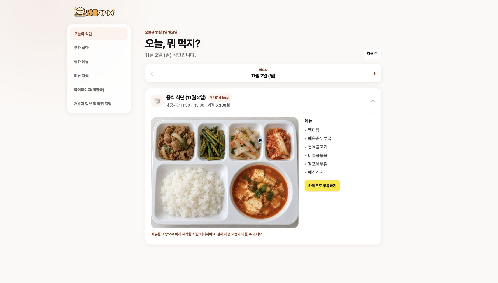

# 밥풀매니아

### 오늘의 학식을 가장 쉽고 맛있게 확인하는 방법

성공회대학교 학식 메뉴를 식판 이미지와 예상 열량으로 한눈에 보여주는 서비스입니다.

[**밥풀매니아 바로가기**](https://babfullmania.vercel.app/#home)

## 메뉴 이름만 보던 학식표를, 고르기 쉬운 식사 경험으로

밥풀매니아는 단순한 텍스트 식단표에서 한 걸음 더 나아갑니다. 오늘 제공되는 음식을 식판 위에서 미리 확인하고, 예상 열량과 제공시간까지 함께 살펴본 뒤 먹고 싶은 메뉴를 빠르게 찾을 수 있습니다.

## 밥풀매니아에서 할 수 있는 것

- **오늘의 식단 한눈에 보기** — 조식과 중식 메뉴, 제공시간, 가격, 예상 열량을 한 화면에서 확인합니다.
- **식판 이미지로 미리 보기** — 실제 메뉴만 반영해 제작·검수한 식판 이미지로 한 끼의 구성을 직관적으로 보여줍니다.
- **이번 주 식단 탐색** — 월요일부터 금요일까지 버튼으로 오가며 이번 주와 다음 주 식단을 미리 확인합니다.
- **주간·월간 메뉴 확인** — 가로형 주간 식단과 월력형 메뉴로 원하는 날짜의 식사를 빠르게 찾아봅니다.
- **먹고 싶은 메뉴 검색** — 과거 식단까지 포함해 메뉴를 검색하고, 언제 어떤 식사로 제공됐는지 확인합니다.
- **예상 열량 제공** — 식품영양성분 데이터와 메뉴별 배식량을 바탕으로 한 끼의 예상 열량을 안내합니다.
- **카카오톡으로 공유** — 마음에 드는 조식·중식 카드를 카카오톡 친구나 채팅방에 바로 공유합니다.
- **모바일 최적화** — 휴대전화에서도 메뉴, 식판 이미지, 월간 달력과 검색 결과를 편하게 볼 수 있습니다.

## 식단을 정확하게 유지하는 운영 기능

식단 정보 가져오기와 수동 등록, 제공 여부·휴무 관리, 메뉴별 사진과 완성 식판 이미지 관리 기능을 갖추고 있습니다. 운영 대시보드에서는 이용 현황과 식사별 통계를 확인할 수 있으며, QR 정기권 스캐너와 사용자 이용 기록 기능도 함께 개발하고 있습니다.

## 서비스 안내

- 식단 원천 정보는 학생 제보형 서비스 [영준.com](https://xn--vj5bw8c.com/babfullmenu)을 활용합니다.
- 식판 이미지는 메뉴 이해를 돕기 위한 참고 이미지로 실제 제공 모습과 다를 수 있습니다.
- 열량은 공공 식품영양성분 자료와 기준 배식량으로 계산한 예상값입니다.
- 마이페이지와 QR 정기권은 현재 개발 중이며 실제 이용 정보와 일치하지 않을 수 있습니다.

밥풀매니아는 김학수 교수님의 **AI활용프로그래밍** 수업 산출물의 일환으로 제작되었습니다.
